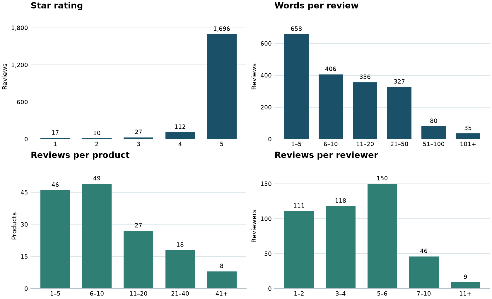

# Team 7 · local model and EDA review

Working draft for Kekelani Dayo and Royian Chowdhury. Ten of the 35 cleaned reviews longer than 100 words were sampled with seed 7. The two examples requested for the report are summaries 1 and 2. These unusually long reviews do not represent a typical review in this dataset (median: 8.5 words).

The Qwen2.5-3B-Instruct model ran locally with llama.cpp. It received each original review and source-specific guidance, and produced 16 candidate paragraphs per review. Summaries 4 and 7 are intact model outputs. The other eight combine whole model-written sentences from drafts of the same review, without word edits. The service reply is a separate single response. See [run instructions](LOCAL_HF.md) and the [paired source texts and results](outputs/hf_summaries.csv). The desktop package also includes the complete raw run log.

Compare each summary to the matching task in the [original review inputs](https://github.com/RoyianChow/comp262-team7/blob/3338788fc8d10c89b1f846306cfe0622b5747152/1%20Code/outputs/hf_summary_inputs_TEMPLATE.csv). Check whether it preserves the reviewer's main point and sentiment. Flag invented details, an omitted correction or a misleading generalization by task number. All ten source rows are distinct; lengths were checked in Python by splitting on whitespace.

### 1. Source row 1955 · 114 source words → 50 words

The reviewer gave five stars due to the flexibility of gift cards, allowing the birthday person to choose their own treat. While acknowledging gift cards lack personal touch, the reviewer prefers this over unexpected practical items like vacuum or sink mats. The tin packaging adds an extra touch of appeal.

### 2. Source row 1000 · 381 source words → 50 words

Initially frustrated, the customer found their Noodles gift card fully funded after checking online. According to the update, only the last 14 digits should be entered, omitting the first 5 digits for a 19-digit card. The customer wishes Amazon or the seller had included this information in the product description.

### 3. Source row 2095 · 101 source words → 50 words

The customer attempted to use an Amazon Sephora eGift card in a physical store but found it unworkable. The customer spent thirty minutes trying to resolve the issue by contacting multiple service numbers, feeling belittled by staff. Although the card didn't work in-store, it did function online, providing some relief.

### 4. Source row 637 · 461 source words → 50 words

The miniature brown shipping box reminded the reviewer of a familiar Amazon delivery, featuring a removable flap that securely holds the card. This reusable packaging is super adorable and great for Amazon fans, earning five stars. The reviewer recommends this to others, especially those fond of the Amazon brown box.

### 5. Source row 626 · 162 source words → 50 words

The reviewer found the miniature Amazon gift boxes cute and organized them by denomination, matching each style to the same amount. While the shrink-wrapped boxes concealed the dollar amounts, the hidden magnets worked effectively to keep the boxes closed. This unique packaging adds a fun element to gift card giving.

### 6. Source row 2266 · 110 source words → 50 words

The reviewer enjoys Olive Garden for its tasty food and kid-friendly menu. They recently bought a gift card for themselves at a 20% discount during a Christmas Lightning Deal, finding this a good price. For personal purchases, the reviewer seeks discounts, opting for full-price cards only for giving as gifts.

### 7. Source row 1821 · 106 source words → 50 words

The reviewer enjoys Panera's quick, healthy soups and sandwiches. Their favorites are the tomato and broccoli cheese. They appreciate giving gift cards, as it encourages visits and sometimes leads to invitations to share meals. The reviewer values this experience for family members who have many belongings, making a thoughtful gift.

### 8. Source row 2578 · 168 source words → 50 words

The reviewer chose a silver-print envelope with a white bow for a wedding gift. It features a clear window revealing a gift card accessible via a pull tab. It adds weight, so checking postage is recommended for mailing inside a wedding card. Since purchased, the reviewer has bought several more.

### 9. Source row 1139 · 167 source words → 50 words

The family frequently shops at JCPenney for children's school uniforms, often buying several at once. They appreciated the May Lightning Deal offering a 20% discount on a gift card meant for personal use. By combining this discounted gift card with store sales and coupons, they saved significantly on their purchases.

### 10. Source row 1842 · 133 source words → 50 words

The reviewer uses gift cards for unusual arrangements in baskets or flowerpots, attaching them to craft sticks. Homemade cake pops or candies fill the space, creating a personalized touch. They make lovely gifts for both teachers and guys alike. Every person who received these arrangements praised their beauty and uniqueness.

## Customer service example

**Original question (row 1518, spelling preserved):** Can you use Whole Food gift gard on Amazon purchaes?

**Model reply:** No, Whole Foods Market gift cards cannot be used for purchases on Amazon.com. They can only be used at Whole Foods Market stores in the United States and Canada.

Review the answer for accuracy, tone and any unsupported promise. [Issuer's gift card redemption terms](https://www.wholefoodsmarket.com/legal/gift-cards-terms-and-conditions). This is a classroom example; it was never sent to a customer.

## Exploratory data analysis

The top panels count reviews; the bottom panels count products and reviewers. These are the 1,862 cleaned 5-core reviews, before taking the 1,000-review comparison sample. Ratings of four or five stars account for 1,808 reviews; just 27 are neutral and 27 are negative by the star-based labels. Accuracy alone can hide poor results on these smaller groups.

Please record any technical corrections in the review issue. Use the team’s private report to confirm the meeting register and each member’s actual contributions; keep individual peer evaluations private.
